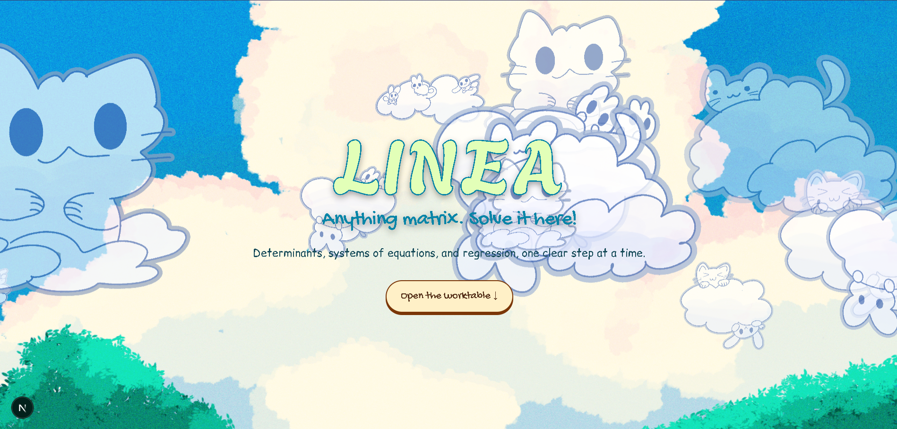
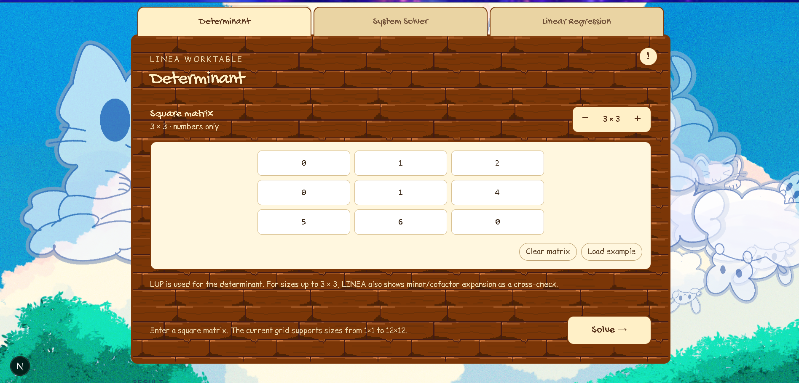
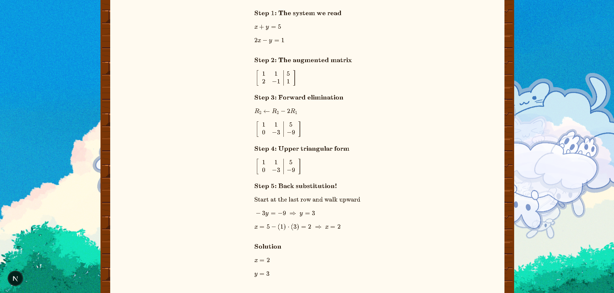

<div align="center">

# LINEA!

Visualize step by step solution for your linear algebra problems!

</div>

##  Screenshots





---

## Features

So what does Linea bring to the table? Besides cute cat cloud background animation ofc!

### Determinant
- Computed with **LUP decomposition**, showing every row swap, the `P`, `L` and `U` matrices, and the sign/diagonal-product step.
- For matrices up to **3×3**, LINEA also computes the determinant by **minor/cofactor expansion**!

### System Solver
- Type your equations the way you'd write them on paper, one per line (e.g. `2x - y = 1`). You can use any kinds of variable, be consistent!
- Choose your method: **Gaussian elimination** or **LU decomposition**.
- Shows the augmented matrix, each elimination step, and the back substitution, and finally the solution.

### Linear Regression
- Enter points as `(x, y)` pairs, e.g. `(0, 1) (1, 2) (2, 2.5)`, from 2 to 100 points.
- Fits a least-squares straight line `ŷ = b₀ + b₁x` by building the design matrix and solving the normal equations `XᵀX β = Xᵀy` with LUP.
- Reports the fitted function! Alongside a table of predictions and residuals, **MAE**, and **R²**.

Pretty neat right??

---

## Tech Stack!

| Layer | What's used |
| --- | --- |
| Framework | [Next.js](https://nextjs.org/) 16 (Pages Router) with the React Compiler, React 19 |
| Styling | Tailwind CSS 4 |
| Maths engine | C++17 compiled to WebAssembly with [Emscripten](https://emscripten.org/) |
| Math rendering | [KaTeX](https://katex.org/) |
| Background animation | [PixiJS](https://pixijs.com/) |

All of these tools were used in order to create Linea! Other assets were designed by using **Ibis Paint** and **Aseprite**

---

## Getting Started!

Here's how you can modify Linea or run it locally.

| Tool | Notes |
| --- | --- |
| [Git](https://git-scm.com/downloads) | to clone the repo |
| [Node.js](https://nodejs.org/) | Required by Next.js 16. | 

### 1. Clone
 
```bash
git clone https://github.com/nabeellagi/linea.git
cd linea
```
 
### 2. Install dependencies
 
 
```bash
npm install
```
 
### 3. Run the dev server
 
```bash
npm run dev
```

Then open **<http://localhost:3000>** in your browser. Scroll down (or hit **Open the worktable ↓**) and start solving.

---

